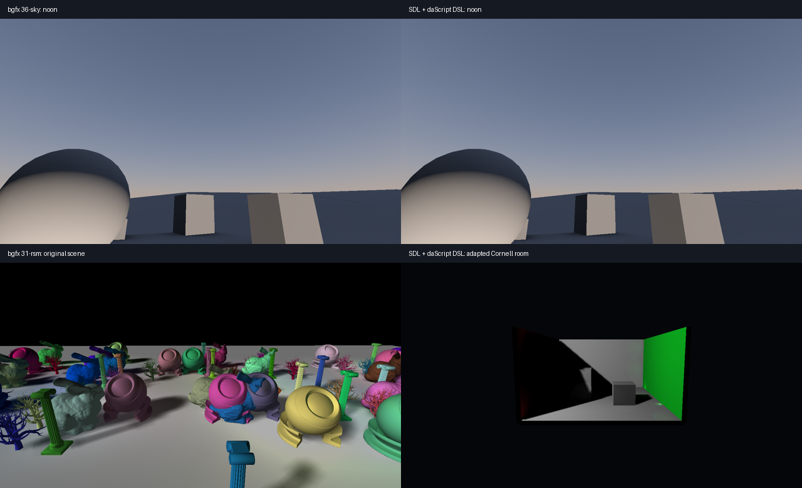

# Sky and RSM: bgfx comparison

Audit date: 2026-10-20. Reference: bgfx commit `7e3060ccb97959dcda3f091b96d82515197028e0`,
[36-sky](https://github.com/bkaradzic/bgfx/tree/7e3060ccb97959dcda3f091b96d82515197028e0/examples/36-sky) and
[31-rsm](https://github.com/bkaradzic/bgfx/tree/7e3060ccb97959dcda3f091b96d82515197028e0/examples/31-rsm).
All rendering algorithms and UI additions remain local to the examples; no public binding API was added.

## Sky: restored upstream behavior

The previous port used a noon-only approximation, invented sun movement, per-fragment Perez evaluation,
exposure 0.15, a different bloom denominator and different noise. Those changed both the image and cost.

The port now uses the original monthly orbit/latitude/time calculation, complete sun/sky XYZ luminance
tables with interpolation, exposure 0.1, sun disk/bloom and interleaved gradient noise. Perez is evaluated
on the original 32×32 vertex grid (1024 vertices, 1922 triangles). Landscape is drawn before sky, which
uses depth EQUAL at the far plane. The original landscape, lightmap and initial camera pose are retained.
The shader DSL preserves the source's two distinct XYZ-to-RGB matrices and `pow(abs(rgb),1/2.2)` gamma.

At fixed noon, June, latitude 50°, turbidity 2.15, with dithering enabled, the Vulkan capture differs
from bgfx by **0.000750/255 mean absolute channel error**; **99.999891% of channels differ by at most 2/255**.
This measures that configuration only. Interpreter and strict-AOT captures are byte-identical.

Remaining differences: fixed camera instead of free-camera navigation; 32-byte grid vertices and
32-bit indices instead of compact 8-byte vertices/16-bit indices; SDL D32 depth; small bx/daScript
trigonometric rounding differences. The UI layout and added landscape/lightmap/pause/reset controls differ.

## RSM: an adaptation with a different workload

The existing port is still substantially different from bgfx. Adding the original controls does not
make these algorithms or scenes equivalent.

| Aspect | bgfx 31-rsm | Current SDL port |
|---|---|---|
| Scene | 222 placed objects, six mesh types, ground | Cornell room and six boxes |
| Initial camera | (0, 1.5, 0), pitch −0.3 | (0, 3, −22) |
| RSM | 512×512, BGRA8 flux/tint + D16 | 256×256, RGBA16F position/normal/flux + D32 |
| Camera G-buffer | BGRA8 normal/albedo + D32F; reconstruct positions | RGBA16F position/normal/albedo + D32 |
| Indirect lighting | Separate BGRA8 light buffer; 1024 sphere draws | 64 fullscreen gather samples in combine |
| VPL radius/falloff | Radius scaled by RSM alpha; linear falloff | Global cutoff; inverse-square gather with sender normal |
| Direct light / shadows | Directional, PCF16 (4×4), normal offset .003, bias .001 | Point light, PCF9 (3×3), bias .012 |
| Draws / triangles | Measured 1653 / 14,981,675 | 13 / 145 |

The original **does not instance its 1024 VPL sphere draws**; previous port documentation claiming this
was incorrect. The original source comments propose instancing as a future optimization.

Fixed here: `RSM Amount` now blends direct and indirect contributions as in upstream, instead of adding
an indirect boost. Unrelated ambient 0.02 and Reinhard tone mapping were removed. Amount defaults to .25;
VPL radius and light azimuth/elevation now affect rendering. Existing direct/flux debug modes remain.

An equal-work RSM comparison first needs the original meshes/placements/camera, 512×512 RSM and original
formats, reconstructed positions, separate light-volume pass with 1024 spheres, radius/falloff and
shadow filtering. The present timings cannot identify binding or renderer overhead.

## ImGui controls and launch

Both originals have Settings panels. Both ports now provide working panels through the existing
daScript ImGui/SDL3 GPU integration. Raw events reach ImGui before owned event decoding; keyboard
shortcuts respect ImGui keyboard capture. Resources use existing scoped wrappers.

Sky: Time scale 0–1, Time 0–24, Latitude −90–90, Turbidity 1.9–10, Prevent color banding and all 12 months;
also Landscape, Lightmap, Paused and Reset. RSM: Amount 0–.7, VPL Radius .25–20, Azimuth 0–360,
Elevation 35–90; also display mode, Paused and Reset. The panel explicitly labels RSM as an adapted gather.

Run from the repository root, using a libraries runner built with ImGui:

```powershell
$env:SDL_GPU_DRIVER = 'vulkan' # or 'direct3d12' with shadercross
./build/ninja/bin/dasSDL3_libraries_runner.exe examples/gpu_port_bgfx/example_27_sky/main.das
./build/ninja/bin/dasSDL3_libraries_runner.exe examples/gpu_port_bgfx/example_22_rsm/main.das
```

Append `--smoke-test` for three frames. A core runner without the ImGui module automatically selects the
keyboard-only path. Shader DSL code is used in both paths; runtime does not depend on bgfx.

## Measured performance

NVIDIA GeForce RTX 4080 Laptop GPU, driver 566.26; Intel Core i9-14900HX; Windows x64.
Vulkan, physical 1280×720, Release `/O2`, single sampling, immediate SDR presentation, no UI/VSync/delay.
GPU debug is disabled for these benchmarks; functional tests enable validation. Each process warms up
for 2 seconds and measures 5 seconds; three sequential trials per runner, interleaved by runner.
Compilation/resource creation are excluded. SDL's final GPU drain is included.

| Scene | Runner | Median ms/frame | Median FPS | Range ms/frame |
|---|---|---:|---:|---:|
| sky | bgfx | 0.643 | 1556 | 0.615–0.702 |
| sky | interpreter | 0.517 | 1934 | 0.511–0.552 |
| sky | aot | 0.567 | 1764 | 0.516–0.594 |
| rsm | bgfx | 3.093 | 323 | 3.091–3.099 |
| rsm | interpreter | 0.667 | 1498 | 0.642–0.695 |
| rsm | aot | 0.679 | 1473 | 0.612–0.708 |

These are whole-frame throughput measurements, not isolated FFI or GPU-call timings. Renderer threading,
presentation and buffering differ. Variance is visible even across three trials; these results do not
establish a universal AOT/interpreter or SDL/bgfx advantage. Sky's geometry and shader behavior now
match closely, but RSM's much lower cost is primarily a different workload.

Machine-readable trials and metadata: [sky-rsm-2026-10-20.json](benchmarks/sky-rsm-2026-10-20.json).



## Verification and reproduction

All **12/12** focused CTests passed: Sky/RSM core rendering under interpreter and strict AOT,
plus three-frame ImGui smoke runs, on both Vulkan and D3D12. Regressions cover solar/luminance/grid
fixtures, sky/calendar/dither/lightmap changes, RSM amount/radius/light changes, and resize behavior.
No validation errors were reported. Strict AOT disables interpreter fallback. GUI smoke runs use the
libraries interpreter; they are not a claim of GUI AOT coverage. Metal and other OSes were not tested.
Both scenes' interpreter/AOT captures are byte-identical; the image comparison above is Vulkan-only.

```powershell
cmake -S . -B build/ninja -DDASSDL3_SKY_RSM_AUDIT=ON
cmake --build build/ninja --target sky_rsm_aot_runner --parallel 6
ctest --test-dir build/ninja -R '^sky_rsm_audit_' --output-on-failure
```

Native reference preparation requires the pinned bgfx checkout with existing VS2022 projects and
cached Release dependencies. The helper hash-checks upstream sources, then writes isolated audit
source/project copies under `.build`; it does not edit original source or dependency files.
Build in a VS developer shell:

```powershell
python tools/prepare_bgfx_sky_rsm_bench.py --bgfx C:/src/bgfx
msbuild C:/src/bgfx/.build/projects/vs2022/audit-36-sky.vcxproj /p:Configuration=Release /p:Platform=x64 /p:BuildProjectReferences=false /m:6
msbuild C:/src/bgfx/.build/projects/vs2022/audit-31-rsm.vcxproj /p:Configuration=Release /p:Platform=x64 /p:BuildProjectReferences=false /m:6
python tools/benchmark_bgfx_sky_rsm.py --bgfx C:/src/bgfx --runner C:/src/dasSDL3/build/ninja/bin/dasSDL3_runner.exe --aot-runner C:/src/dasSDL3/build/ninja/bin/sky_rsm_aot_runner.exe --output sky-rsm-benchmarks.json
```

Do not overlap benchmark processes or other GPU workloads. The script runs native binaries from
`examples/runtime`, enforces Vulkan/physical-size verification and saves each trial's output.
For captures, set `BGFX_AUDIT_CAPTURE` to an absolute output stem when running one native audit binary;
the callback writes a TGA. Set `DASSDL3_BGFX_CAPTURE` to an output folder when running
`tests/sky_rsm_audit.das`, which writes raw 1280×720 RGBA8 files. Compare with:

```powershell
python tests/test_sky_bgfx_reference.py --reference C:/path/sky.tga --capture C:/path/sky-noon.rgba
```

The image comparator requires Pillow and NumPy. Native captures exclude UI.
