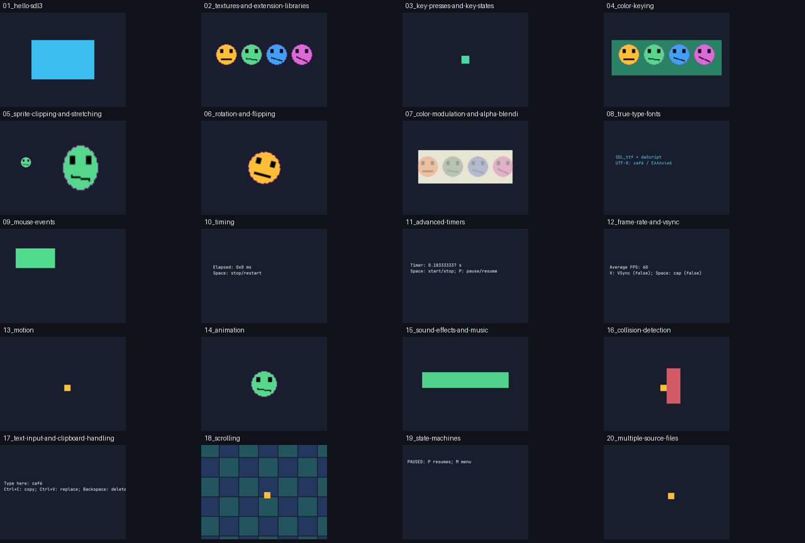

# SDL3 topics from Lazy Foo, in daScript

Twenty independent examples following the topic order of [Beginning Game Programming v3.0](https://lazyfoo.net/tutorials/SDL3/index.php), checked 2026-10-20.
The introduction (00) has no runnable program. These are original implementations, not translations of the tutorial text/code or reproductions of its artwork. The upstream FAQ restricts tutorial reuse and requires permission for source reuse: https://lazyfoo.net/faq.php . No upstream code, media or prose is redistributed.

Each numbered entry is runnable with the libraries runner. Scope ownership, Result errors, sdl_try, sdl_use and owned event variants are used throughout. Common application helpers stay in this directory; no public binding abstraction was added.

From the repository root, in a configured developer terminal:

```powershell
cmake -S . -B build/ninja -DDASSDL3_WITH_IMAGE=ON -DDASSDL3_WITH_TTF=ON -DDASSDL3_WITH_MIXER=ON
cmake --build build/ninja --target dasSDL3_libraries_runner --parallel 6
```

Then run a numbered entry:

```powershell
./build/ninja/bin/dasSDL3_libraries_runner.exe ./examples/sdl_port_lazyfoo/01_hello-sdl3.das
```

Add `--smoke-test` for twelve deterministic frames, scripted input and assertions. The loop invokes the same event handlers with synthetic owned events; it does not pretend to simulate OS keyboard state. `SDL_RENDER_DRIVER=software` supports deterministic pixel tests. `DASSDL3_LAZYFOO_CAPTURE` writes the final backbuffer as BMP before present.

PNG/BMP sprites and a short WAV melody are created by tools/prepare_lazyfoo_assets.py; they are original project resources under the repository license. The font is the existing JetBrains Mono library asset, with its existing license. CMake copies assets alongside the libraries runner.



## Topics and controls

- [01-hello-sdl3](01_hello-sdl3.das) — [topic](https://lazyfoo.net/tutorials/SDL3/01-hello-sdl3/index.php)
- [02-textures-and-extension-libraries](02_textures-and-extension-libraries.das) — [topic](https://lazyfoo.net/tutorials/SDL3/02-textures-and-extension-libraries/index.php)
- [03-key-presses-and-key-states](03_key-presses-and-key-states.das) — [topic](https://lazyfoo.net/tutorials/SDL3/03-key-presses-and-key-states/index.php)
- [04-color-keying](04_color-keying.das) — [topic](https://lazyfoo.net/tutorials/SDL3/04-color-keying/index.php)
- [05-sprite-clipping-and-stretching](05_sprite-clipping-and-stretching.das) — [topic](https://lazyfoo.net/tutorials/SDL3/05-sprite-clipping-and-stretching/index.php)
- [06-rotation-and-flipping](06_rotation-and-flipping.das) — [topic](https://lazyfoo.net/tutorials/SDL3/06-rotation-and-flipping/index.php)
- [07-color-modulation-and-alpha-blending](07_color-modulation-and-alpha-blending.das) — [topic](https://lazyfoo.net/tutorials/SDL3/07-color-modulation-and-alpha-blending/index.php)
- [08-true-type-fonts](08_true-type-fonts.das) — [topic](https://lazyfoo.net/tutorials/SDL3/08-true-type-fonts/index.php)
- [09-mouse-events](09_mouse-events.das) — [topic](https://lazyfoo.net/tutorials/SDL3/09-mouse-events/index.php)
- [10-timing](10_timing.das) — [topic](https://lazyfoo.net/tutorials/SDL3/10-timing/index.php)
- [11-advanced-timers](11_advanced-timers.das) — [topic](https://lazyfoo.net/tutorials/SDL3/11-advanced-timers/index.php)
- [12-frame-rate-and-vsync](12_frame-rate-and-vsync.das) — [topic](https://lazyfoo.net/tutorials/SDL3/12-frame-rate-and-vsync/index.php)
- [13-motion](13_motion.das) — [topic](https://lazyfoo.net/tutorials/SDL3/13-motion/index.php)
- [14-animation](14_animation.das) — [topic](https://lazyfoo.net/tutorials/SDL3/14-animation/index.php)
- [15-sound-effects-and-music](15_sound-effects-and-music.das) — [topic](https://lazyfoo.net/tutorials/SDL3/15-sound-effects-and-music/index.php)
- [16-collision-detection](16_collision-detection.das) — [topic](https://lazyfoo.net/tutorials/SDL3/16-collision-detection/index.php)
- [17-text-input-and-clipboard-handling](17_text-input-and-clipboard-handling.das) — [topic](https://lazyfoo.net/tutorials/SDL3/17-text-input-and-clipboard-handling/index.php)
- [18-scrolling](18_scrolling.das) — [topic](https://lazyfoo.net/tutorials/SDL3/18-scrolling/index.php)
- [19-state-machines](19_state-machines.das) — [topic](https://lazyfoo.net/tutorials/SDL3/19-state-machines/index.php)
- [20-multiple-source-files](20_multiple-source-files.das) — [topic](https://lazyfoo.net/tutorials/SDL3/20-multiple-source-files/index.php)

All windows: Escape/close exits. 03: arrow presses plus held keyboard state. 05: Space selects clip. 06: Left/Right rotates, Space mirrors horizontally, V flips vertically. 07: Space changes opacity, R changes red modulation. 09: hover/click the button. 10: Space stops/restarts. 11: Space starts/stops, P pauses/resumes. 12: V toggles VSync, Space toggles manual cap (unsupported VSync is reported as an SDL error). 13/16/18/20: arrow keys. 15: Space plays looping melody, P pauses/resumes, S stops, Enter plays effect. 17: typing, Ctrl+C/Ctrl+V, UTF-8 Backspace. 19: Enter/Space changes state, P pauses/resumes, M returns to menu.

## Deliberate differences

Original C++ classes/global resources are replaced by small local state, scoped resources and result propagation. Texture/animation artwork, text, layout and music are different. Text uses the existing SDL_ttf text-engine wrapper. Motion is time-based and focus loss resets velocity; collision is axis-separated AABB. Multiple source files uses daScript modules instead of C++ headers. SDL_mixer3 tracks play the original generated melody/effect. This is feature/topic coverage, not a claim of pixel-identical ports.

## Verification

```powershell
python tests/test_lazyfoo_examples.py --runner build/ninja/bin/dasSDL3_libraries_runner.exe --output build/ninja/lazyfoo-interpreter
cmake -S . -B build/ninja -DDASSDL3_LAZYFOO_AOT=ON
cmake --build build/ninja --target lazyfoo_aot_runner --parallel 6
ctest --test-dir build/ninja -R "^lazyfoo_(aot_)?examples$" --output-on-failure
```

Tests use dummy video/audio, twelve bounded frames, real software-renderer readback, per-topic pixel oracles and separate timer/input/collision/UTF-8 state contracts. AOT must report `main AOT=yes; fallback disabled`, and its software-rendered frames must match interpreter output byte-for-byte. The tests do not establish physical audio playback or platform-specific input/clipboard support. Pillow is needed for image checks and optional asset regeneration, not for running the examples.

Validated on Windows x64: 21 interpreter cases, 21 strict AOT cases, 20 byte-identical frame pairs, and four reproducible assets. See [recorded evidence](validation/2026-10-20.json).

## Visible Windows / real audio check

```powershell
python tools/check_lazyfoo_desktop.py
python tools/check_lazyfoo_desktop.py --lesson 15
$env:SDL_AUDIO_DRIVER='wasapi'
./build/ninja/bin/dasSDL3_libraries_runner.exe tests/lazyfoo_desktop_audio.das --smoke-test
```

The desktop launcher runs normal interactive entries, without `--smoke-test`, using Windows video, WASAPI audio and automatic renderer selection. Each window stays open until Escape/close (180 seconds by default, adjustable with `--timeout`). It clears inherited dummy-driver settings and the smoke clipboard/capture hints only for child processes. The audio test emits a quiet 440 Hz tone and asserts that the playback cursor advances, stays fixed during pause, resumes and stops. These hardware checks are opt-in and are not part of the default CI suite.

On 2026-10-20 all twenty windows were observed and closed cleanly using actual Windows UI input. A separate driver probe reported `windows / direct3d11 / wasapi`. Music controls, timers, VSync, button interaction and physical-key text input/Backspace worked. Audio frame positions were 12960 before/during pause and 24960 after resume. This proves real audio-engine playback progress, not acoustic audibility at speakers.

Automation limitation: its `Right` input arrived as `Keypad 6` (SDL scancode 94), not `Right` (79). Continuous physical-arrow movement/collision/camera still need a manual check; the binding was not changed to reinterpret keypad events. Unicode packet injection through the automation typing API produced no text, whereas physical-key input generated text in the current keyboard layout. No system clipboard mutation was performed. See [desktop evidence](validation/2026-10-20-desktop.json); the earlier strict-AOT/dummy evidence is separate.

For the physical-arrow check, run `./build/ninja/bin/dasSDL3_libraries_runner.exe tests/lazyfoo_desktop_input.das` and press arrows in its focused window. It prints the received SDL keycode/scancode and text events; Escape exits.
